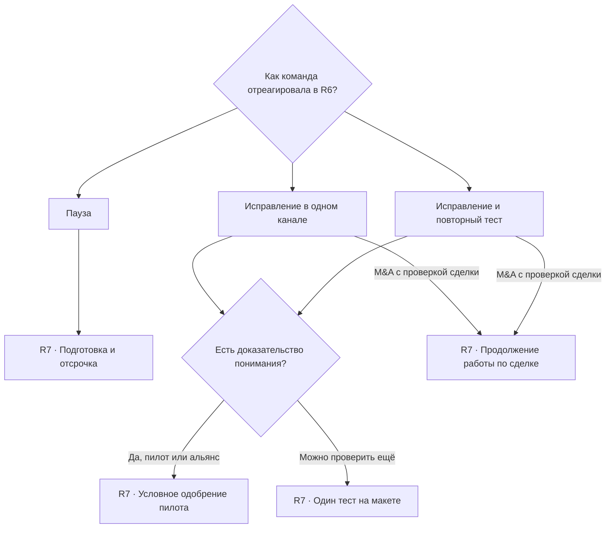

# Revolut — One Market First

Очная симуляция по стратегическому менеджменту. Четыре команды консультантов разрабатывают выход Revolut на рынки Индонезии, Филиппин, Таиланда и Вьетнама. Каждая команда начинает с 9 кредитов и строит стратегию для одного рынка. Победившая команда получает финансирование следующего этапа, а её рынок — право первого запуска при выполнении условий совета. Работа и защита проходят на английском. Обязанности внутри команды участники распределяют сами.

[Сценарий и памятка для ведущих в Google Docs](https://docs.google.com/document/d/1cuo4E4ZLuK9YBVcbddPkt3VGxIf15okW84XUBjwIlBY/edit)

## Запуск

1. Для проверки откройте [one-market-first.html](one-market-first.html) в браузере или запустите локальный сервер (раздел «Проверка на localhost» ниже). Для репетиции нажмите **Practice without a room**. Режим практики открывает следующий раунд по кнопке и позволяет вручную раскрыть второй кризисный бюллетень.
2. Для Tilda вставьте **три блока T123 → HTML-код** на одну страницу, строго в этом порядке сверху вниз, и опубликуйте её: [01-t123-html-css.txt](01-t123-html-css.txt) (стили и разметка), [02-t123-game-engine.txt](02-t123-game-engine.txt) (правила и данные), [03-t123-game-interface.txt](03-t123-game-interface.txt) (интерфейс). В каждый блок копируйте всё содержимое файла целиком. Один общий блок Tilda не принимает, поэтому игра разделена на три. Если вставить третий блок без второго, игра сообщит, что не хватает блока движка. Внешний сервер и дополнительные платные сервисы не требуются. Три файла создаёт `node scripts/build.mjs`, вручную их править не нужно.
3. На устройстве ведущего откройте **Facilitator → Create a new room**. На панели есть блок **What’s next**: чек-лист из шести шагов (комната создана, столы вошли, игра сыграна, файлы команд собраны, листы экспертов заполнены, рейтинг и экспорт) с подсказкой, что делать сейчас. Страница не видит команды, поэтому шаг «столы вошли» отмечается вручную (он считается выполненным и сам, когда игра закончилась или импортирован файл команды). Введите время старта R1 по Москве. Для согласованного расписания выберите **18:30**. Система выдаст код комнаты и случайно назначит четыре разных рынка четырём столам.
4. На входе распределите иностранных студентов по разным столам настолько равномерно, насколько позволяет состав группы. Остальных распределите до четырёх близких по размеру команд. Участники вводят один общий код и номер своего стола.
5. После R4 скачайте JSON команды. Игровой журнал остаётся в браузере. При смене устройства откройте страницу и нажмите **Restore JSON**. После R7 скачайте JSON для экспертов. В окно подготовки заполните **Board Brief** и скачайте отдельный TXT для защиты.

Раунды идут по единому серверному времени: при открытии страницы по http(s) игра сверяет часы с заголовком `Date` сервера, с которого загружена страница (Tilda), и повторяет сверку каждые 10 минут. Если часы устройства отстают или спешат, игра сообщает об этом и следует серверному времени. Если страницу открыли как файл с диска, серверного времени нет: игра использует часы устройства и предупреждает об этом, поэтому сверьте часы вручную и держите на проекторе таймер ведущего. На каждый стол нужен один браузер. Финансовых операций в игре нет. Рыночные источники перечислены в досье, исследовательские результаты и события являются учебными данными.

## Проверка на localhost

Нужен [Node.js](https://nodejs.org) версии 20 или новее (`node --version`). Установка пакетов не требуется.

```bash
git clone https://github.com/danilsushko104-commits/Strategy-game.git
cd Strategy-game
git checkout claude/lucid-wozniak-rcrpub
npm start
```

`npm start` собирает игру и запускает сервер на http://localhost:8080/. Откройте этот адрес в браузере. Если порт занят, используйте `node scripts/serve.mjs --port=3000`.

Почему лучше сервер, а не файл с диска: по `http://` игра сверяет часы с сервером (как в Tilda), а при открытии файла работает на часах вашего устройства и предупреждает об этом.

**Как проверить игру целиком:**

1. **Репетиция.** Нажмите **Practice without a room**: можно пройти все раунды по кнопкам, без часов.
2. **Живая комната.** Нажмите **Facilitator → Create a new room** и задайте старт R1 **по Москве**. Чтобы сразу оказаться в нужном месте, поставьте старт в прошлом на столько минут раньше текущего времени: R1 — 5; R2 — 20; R3 — 40; R4 — 55; перерыв — 65; R5 — 75; R6 до второго бюллетеня — 86 (бюллетень B откроется на 92-й минуте); R7 — 110; подготовка Board Brief — 125; защиты — 135; итоги занятия — 148. Через 150 минут наступает «END»: студенты видят результат игры.
3. **Несколько столов.** Откройте четыре вкладки с тем же кодом комнаты и разными столами (1–4): каждый стол хранит данные отдельно. Панель ведущего открывайте в пятой вкладке. Для проверки восстановления и резервных копий удобно открыть вкладку в приватном окне как «второе устройство».
4. **Телефон в той же сети Wi-Fi.** Запустите `node scripts/serve.mjs --lan` и откройте на телефоне адрес из строки «same Wi-Fi». Это обычный `http`, поэтому часть возможностей браузера (постоянное хранение, блокировки) не работает, а игра переходит на запасные способы.
5. **Google Sheets.** Запустите `node scripts/serve.mjs --sync-url=https://script.google.com/macros/s/…/exec` (подставьте адрес вашего развёртывания). Игра отправит зафиксированные решения в таблицу; инструкция — в [integrations/google-sheets/README.md](integrations/google-sheets/README.md).
6. **Игровой результат.** После импорта JSON команды в панели ведущего появляются колонки Game и Final. Студентам результат показывается только после занятия (при «END»).
7. **Автоматические проверки.** `npm test` запускает все тесты. Если установлен Playwright (`npm i --no-save playwright && npx playwright install chromium`), запускаются и браузерные.

## Решения и последствия

| Раунд | Время, МСК | Решение | Эффект |
| --- | --- | --- | --- |
| R1 | 18:30–18:46 | Один из двух профилей · 0 | Определяет конкурентов, результаты исследования, ход соперника и уточнение кризиса. Команда сама строит CAGE относительно Сингапура. |
| R2 | 18:46–19:02 | Досье · 0 / интервью · 2 / прототип · 3 | Интервью раскрывает причину возможного перехода. Прототип проверяет первичное понимание продукта и учитывается в результате позднего повторного теста. |
| R3 | 19:02–19:20 | Пилот с провайдером · 2 / альянс · 3 / подготовка M&A · 5 | У всех одна группа на старте. Альянс может добавить вторую. M&A может продолжить проверку сделки. Команда строит план по Uppsala. |
| R4 | 19:20–19:30 | Резерв · 0 / проверка готовности · 2 | Проверка даёт замечание по конкретному сценарию и заранее согласованный шаблон. Точечное исправление становится бесплатным и включает проверку понимания. Полный ответ дешевле на 1. |
| R5 | 19:40–19:54 | Сохранить · 0 / сузить и проверить · 1 / второй канал и группа · 2 / проверка сделки · 1 | Сужение даёт результат теста на 5 участниках. Две группы доступны альянсу. Проверка сделки доступна M&A и раскрывает условие закрытия. |
| R6 | 19:54–20:14 | Пауза · 0 / точечное исправление · 0–1 / полное исправление и повторный тест · 2–4 | Вторая часть события открывается в 20:02. Уточнение зависит от профиля R1. Точечное исправление сохраняет одну группу. Полный ответ может сохранить две. |
| R7 | 20:14–20:29 | Запрос к совету · 0 | Команда выбирает из доступных запросов и формулирует измеримое условие следующего шага. |



Для пилота и альянса доказательство по R6 появляется после прохождения порога полного теста либо после точечного исправления с проверкой R4 либо сужением с тестом R5. Точечный тест проверяет понимание в пяти случаях, полный — в двадцати на группу с порогом 16 из 20. Без проверки или тестирования ранее одна группа в полном тесте набирает 15 из 20 и потребуется ещё один тест. Отсрочка доступна любой команде, а после паузы в R6 это единственное решение. Продолжение сделки требует проверки риска в R5 и публичного исправления в R6. Одобрение работы по сделке не заменяет закрытие, разрешения и проверку готовности.

Минимальный пример альянса на две группы по базовым ценам: 3 за альянс + 2 за второй канал + 4 за повторный тест = 9 (в Индонезии 2 + 3 + 4). Альянс с купленной проверкой, интервью и второй группой тратит 9 до кризиса. Он всё ещё может бесплатно исправить один канал и перейти к условному пилоту с одной группой. Пример M&A: 2 за интервью + 5 за подготовку сделки + 1 за её риск + 1 за исправление = 9.

## Версия v3: игровой результат, различия рынков и случайность

**Итог = 65% оценки экспертов + 35% игрового результата.** Игровой результат (0–100) считается из выбранных решений. В ходе игры команда видит показатель **Board confidence** в закреплённой шапке: сколько баллов уже заработано и сколько ещё максимально возможно из текущего состояния. После R7 на экране результата показан итог по частям (запрос к совету, исследование, проверки, ответ на кризис, резерв). Оценку экспертов и итоговую оценку студенты не видят. Ведущий и эксперты видят игровой результат в панели ведущего после импорта JSON команды: итоговая таблица и CSV содержат оценку экспертов, игровой результат и итог.

**Игровой результат складывается** из запроса к совету (пилот на две группы 70, сделка 54, пилот 45, повторный тест 22, отсрочка 10), исследования клиента, проверки готовности, сужения предложения, ответа на кризис и остатка кредитов (2 за кредит, не больше 5 кредитов, только если запрошен реальный шаг). Новый запрос **«пилот на две группы»** доступен только после альянса, второго канала и пройденного теста в обеих группах.

**Рынки различаются ценой.** Базовые цены (интервью 2, прототип 3, пилот 2, альянс 3, сделка 5, проверка 2, сужение 1, второй канал 2, проверка сделки 1, точечное исправление 1, полный ответ 3 или 4) меняются так:

| Рынок | Изменение |
| --- | --- |
| Индонезия | альянс 2 (−1), второй канал 3 (+1) |
| Филиппины | пилот 1 (−1), проверка готовности 3 (+1) |
| Таиланд | проверка готовности 1 (−1), проверка сделки 2 (+1), результат полного теста −1 |
| Вьетнам | пилот 3 (+1) |

**Выбор проблемы в R6.** Если команда исправляет один канал, она называет проблему из выпадающего списка (комиссии, скорость, охват, сумма, статус платежа). Исправление считается доказанным, только если названа та проблема, о которой спрашивают клиенты её профиля. Другая проблема стоит столько же, но не доходит до клиентов.

**Таймер и подтверждение.** В закреплённой шапке виден таймер этапа. Чтобы зафиксировать решение раньше срока, нужно подтвердить, что оно окончательное.

**Случайность** только в полном повторном тесте: результат может отклониться на −1 или +1 правильный ответ с вероятностью 20% в каждую сторону. Живая комната фиксирует результат по коду комнаты, столу и раунду, поэтому повторное открытие или восстановление из файла его не меняет. В практическом режиме результат зависит от сессии, и повторные репетиции различаются.

**Как менять числа.** Все они в `src/tuning.mjs`. После правки запустите `node scripts/balance.mjs`, затем `node scripts/build.mjs` и `node --test`. Тесты проверяют, что каждый маршрут и каждый вариант остаётся осмысленным, а рынки не расходятся больше чем на 3 балла.

## Расписание семинара и жюри

- **18:10–18:20** · Рассадка и распределение столов.
- **18:20–18:30** · Председатель озвучивает мандат. Ведущий показывает пробный ход с 5 кредитами.
- **18:30–19:30 и 19:40–20:29** · Семь раундов. Ведущий предупреждает за две минуты до блокировки.
- **19:30–19:40** · Перерыв. Сохраните JSON.
- **20:29–20:40** · Команды заполняют Board Brief, эксперты завершают письменную оценку.
- **20:40–20:56** · Четыре защиты по 3 минуты и 1 минуте на общий вопрос. Порядок объявите заранее.
- **20:56–21:00** · Преподаватель как председатель называет победивший рынок, финансируемый шаг и условие запуска.

**Общий вопрос** — “Which assumption most threatens your plan, and what specific evidence would make you change your next commitment?”

Три эксперта независимо оценивают письменную стратегию на 70 баллов и защиту на 30. В панели ведущего импортируйте JSON команды и отметьте каждую из четырёх проверок по строке рубрики. Выберите **This expert sheet is complete** для каждого эксперта. Итог — среднее трёх оценок. При равенстве учитывайте устную оценку, затем Uppsala. При полном равенстве решение принимает преподаватель и называет основание. Игровой финал и остаток бюджета сами по себе баллов не дают. **Export scores CSV** сохраняет оценки: ранг, баллы жюри в целом и по каждому эксперту, письменную и устную часть, Uppsala и статус стола (завершён, ждёт листов экспертов или ничья, которую решает председатель). Числа округлены до одного знака, файл в UTF-8 с BOM. Для Excel есть вторая кнопка: **Export for Excel** (разделитель `;` и десятичная запятая, как ждёт Excel с русскими региональными настройками; файл `…-excel-ru.csv`).

**Когда время вышло.** Выбранное доступное действие с заполненными полями *Evidence or assumption* и *Benefit and trade-off* фиксируется из браузерного черновика. Если хотя бы одного поля не хватает, действуют бесплатные решения по умолчанию в порядке раундов: A → досье → подготовка без выбранного режима → резерв → сохранить → пауза → отсрочка. Остальные заметки рабочего листа не влияют на факт фиксации.

## Хранение и правка

- Состояние команды хранится в `localStorage` страницы под ключом `revolut-one-market-first:v3:<комната>:team:<стол>`. Журнал и Board Brief экспортируются в TXT, перенос и восстановление сессии работают через JSON. Сохранения предыдущей игры остаются доступны старой версии. Для новой сессии создайте комнату с новым кодом.
- **Надёжность сохранения на устройстве.** Игра запрашивает у браузера постоянное хранение (`navigator.storage.persist()`), дублирует каждую запись в IndexedDB и держит кольцо из двух снимков: при каждой фиксации решения предыдущее состояние уходит в `bak1`, а прежний `bak1` — в `bak2`. Правки черновика кольцо не сдвигают. Если запись повреждена или не открывается, вместо ошибки появляется экран восстановления: лучшая читаемая копия (браузерная копия, снимок) или JSON-файл. Повреждённая запись не перезаписывается, пока команда не выберет копию. Браузеры обычно очищают `localStorage` и IndexedDB вместе, поэтому настоящая защита от очистки данных — скачанный JSON.
- **Резервная копия.** В живой комнате после каждой фиксации показывается индикатор: сколько решений не попало в последний скачанный JSON (зелёный — всё сохранено, оранжевый — отстаёт на 1, красный — на 2 и больше).
- **Версия содержания.** В запись сохраняется отпечаток текстов, цен, расписания и рубрики. Если страницу переопубликовали с другим содержанием, игра предупреждает, что показанные тексты и результаты могут отличаться от тех, что видела команда. Изменения самой логики правил по-прежнему защищает `CONFIG.version`.
- **Google Sheets (по желанию).** Если в блоке игры заполнен `data-sync-url`, каждое зафиксированное решение отправляется в вашу таблицу через Apps Script: время приёма ставит Google, строки только добавляются, переписанный раунд попадает в новую строку с пометкой `CONFLICT`. При обрыве связи отправка повторяется сама, повторная отправка безопасна. Подключение и проверка до занятия описаны в [integrations/google-sheets/README.md](integrations/google-sheets/README.md). Без адреса игра работает как раньше.
- **Карта решений и проверка текстов.** [docs/decision-map.md](docs/decision-map.md) показывает, что команда может выбрать в каждом раунде, сколько это стоит на каждом рынке, когда карта недоступна, как отличается история по профилям и сколько цепочек решений есть (создаётся `node scripts/decision-map.mjs`). `node scripts/content-audit.mjs` ищет в текстах и источниках рынка упоминания других стран, валют и учреждений; тест не пропускает такие упоминания.
- **Настройка игрового результата.** Числа, от которых зависят скрытый игровой результат, различия рынков и случайность в повторном тесте, собраны в [src/tuning.mjs](src/tuning.mjs): набор `V3` действует, набор `LEGACY` описывает игру до версии v3. Обоснование чисел и ответы автора — в [docs/game-design-proposal.md](docs/game-design-proposal.md). `node scripts/balance.mjs` оценивает баланс: ценность маршрутов, «мёртвые» варианты, справедливость между рынками и вес игрового результата в итоговой оценке; `node scripts/balance.mjs legacy` оценивает прежнюю игру.
- Панель экспертов хранит записи в браузере ведущего. Для офлайн-семинара можно использовать распечатанные карточки и журнал. Код комнаты привязывает рынок и расписание. Очная игра опирается на наблюдение ведущих и независимую оценку.
- Содержание рынков, досье, событий и рабочих листов находится в [src/scenario.mjs](src/scenario.mjs). Цены, условия ходов, расчёт последствий и таймер — в [src/rules.mjs](src/rules.mjs). Журнал позволяет проверить, почему доступно каждое решение.
- Для изменения интерфейса используйте [src/app.mjs](src/app.mjs), [src/host.mjs](src/host.mjs) и [src/game.css](src/game.css). Часы и серверная сверка — в [src/clock.mjs](src/clock.mjs). После правок выполните `node scripts/build.mjs`. Скрипт обновит оба готовых файла: каждый модуль оборачивается в собственную область видимости, а несуществующие импорты и неподдерживаемые формы `import`/`export` приводят к ошибке сборки. `node --test` проверяет правила, часы семинара, очерёдность событий, восстановление, достижимость финалов, серверную сверку времени и сам собранный файл: актуальность относительно `src/`, корректность скрипта и (если установлен Playwright) полный прогон практического режима в браузере. Зависимости для сборки и тестов не требуются.
