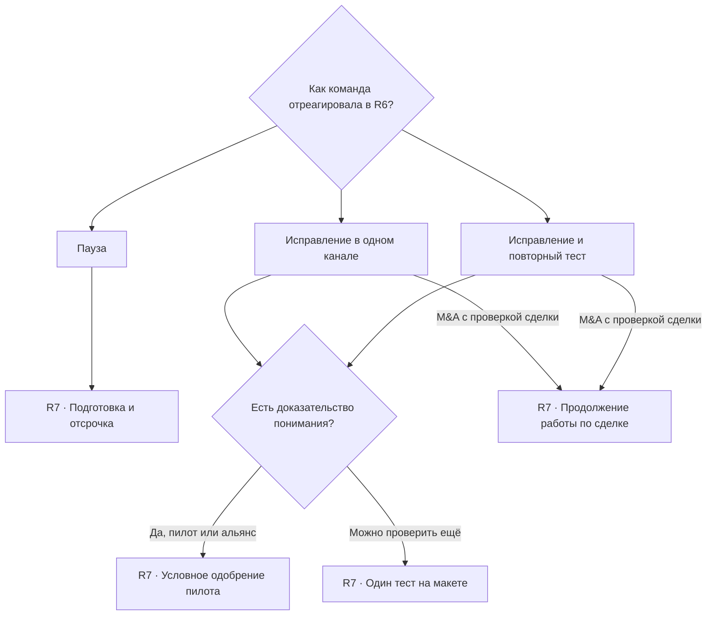

# Revolut — One Market First

Очная симуляция по стратегическому менеджменту. Четыре команды консультантов разрабатывают выход Revolut на рынки Индонезии, Филиппин, Таиланда и Вьетнама. Каждая команда начинает с 9 кредитов и строит стратегию для одного рынка. Победившая команда получает финансирование следующего этапа, а её рынок — право первого запуска при выполнении условий совета. Работа и защита проходят на английском. Обязанности внутри команды участники распределяют сами.

[Сценарий и памятка для ведущих в Google Docs](https://docs.google.com/document/d/1cuo4E4ZLuK9YBVcbddPkt3VGxIf15okW84XUBjwIlBY/edit)

## Запуск

1. Откройте [pravo-na-vhod.html](pravo-na-vhod.html) в браузере. Для репетиции нажмите **Practice without a room**. Режим практики открывает следующий раунд по кнопке и позволяет вручную раскрыть второй кризисный бюллетень.
2. Для Tilda скопируйте всё содержимое [pravo-na-vhod-t123.txt](pravo-na-vhod-t123.txt) в один блок **T123 → HTML-код** и опубликуйте страницу. Блок включает данные, стили и логику. Внешний сервер и дополнительные платные сервисы не требуются.
3. На устройстве ведущего откройте **Facilitator → Create a new room**. Введите время старта R1 по Москве. Для согласованного расписания выберите **18:30**. Система выдаст код комнаты и случайно назначит четыре разных рынка четырём столам.
4. На входе распределите иностранных студентов по разным столам настолько равномерно, насколько позволяет состав группы. Остальных распределите до четырёх близких по размеру команд. Участники вводят один общий код и номер своего стола.
5. После R4 скачайте JSON команды. Игровой журнал остаётся в браузере. При смене устройства откройте страницу и нажмите **Restore JSON**. После R7 скачайте JSON для экспертов. В окно подготовки заполните **Board Brief** и скачайте отдельный TXT для защиты.

Комната работает по часам устройств. Сверьте часы перед занятием и держите на проекторе таймер ведущего. На каждый стол нужен один браузер. Финансовых операций в игре нет. Рыночные источники перечислены в досье, исследовательские результаты и события являются учебными данными.

## Решения и последствия

| Раунд | Время, МСК | Решение | Эффект |
| --- | --- | --- | --- |
| R1 | 18:30–18:46 | Один из двух профилей · 0 | Определяет конкурентов, результаты исследования, ход соперника и уточнение кризиса. Команда сама строит CAGE относительно Сингапура. |
| R2 | 18:46–19:02 | Досье · 0 / интервью · 2 / прототип · 3 | Интервью раскрывает причину возможного перехода. Прототип проверяет первичное понимание продукта и учитывается в результате позднего повторного теста. |
| R3 | 19:02–19:20 | Пилот с провайдером · 2 / альянс · 3 / подготовка M&A · 5 | У всех одна группа на старте. Альянс может добавить вторую. M&A может продолжить проверку сделки. Команда строит план по Uppsala. |
| R4 | 19:20–19:30 | Резерв · 0 / проверка готовности · 2 | Проверка даёт замечание по конкретному сценарию и заранее согласованный шаблон. Точечное исправление становится бесплатным и включает проверку понимания. Полный ответ дешевле на 1. |
| R5 | 19:40–19:54 | Сохранить · 0 / сузить и проверить · 1 / второй канал и группа · 2 / проверка сделки · 1 | Сужение даёт результат теста на 5 участниках. Две группы доступны альянсу. Проверка сделки доступна M&A и раскрывает условие закрытия. |
| R6 | 19:54–20:14 | Пауза · 0 / точечное исправление · 0–1 / полное исправление и повторный тест · 2–4 | Вторая часть события открывается в 20:02. Уточнение зависит от профиля R1. Точечное исправление сохраняет одну группу. Полный ответ может сохранить две. |
| R7 | 20:14–20:29 | Запрос к совету · 0 | Команда выбирает из доступных запросов и формулирует измеримое условие следующего шага. |

Для пилота и альянса доказательство по R6 появляется после прохождения порога полного теста либо после точечного исправления с проверкой R4 либо сужением с тестом R5. Точечный тест проверяет понимание в пяти случаях, полный — в двадцати на группу с порогом 16 из 20. Без проверки или тестирования ранее одна группа в полном тесте набирает 15 из 20 и потребуется ещё один тест. Отсрочка доступна любой команде, а после паузы в R6 это единственное решение. Продолжение сделки требует проверки риска в R5 и публичного исправления в R6. Одобрение работы по сделке не заменяет закрытие, разрешения и проверку готовности.

Минимальный пример альянса на две группы: 3 за альянс + 2 за второй канал + 4 за повторный тест = 9. Альянс с купленной проверкой, интервью и второй группой тратит 9 до кризиса. Он всё ещё может бесплатно исправить один канал и перейти к условному пилоту с одной группой. Пример M&A: 2 за интервью + 5 за подготовку сделки + 1 за её риск + 1 за исправление = 9.

## Расписание семинара и жюри

- **18:10–18:20** · Рассадка и распределение столов.
- **18:20–18:30** · Председатель озвучивает мандат. Ведущий показывает пробный ход с 5 кредитами.
- **18:30–19:30 и 19:40–20:29** · Семь раундов. Ведущий предупреждает за две минуты до блокировки.
- **19:30–19:40** · Перерыв. Сохраните JSON.
- **20:29–20:40** · Команды заполняют Board Brief, эксперты завершают письменную оценку.
- **20:40–20:56** · Четыре защиты по 3 минуты и 1 минуте на общий вопрос. Порядок объявите заранее.
- **20:56–21:00** · Преподаватель как председатель называет победивший рынок, финансируемый шаг и условие запуска.

**Общий вопрос** — “Which assumption most threatens your plan, and what specific evidence would make you change your next commitment?”

Три эксперта независимо оценивают письменную стратегию на 70 баллов и защиту на 30. В панели ведущего импортируйте JSON команды и отметьте каждую из четырёх проверок по строке рубрики. Выберите **This expert sheet is complete** для каждого эксперта. Итог — среднее трёх оценок. При равенстве учитывайте устную оценку, затем Uppsala. При полном равенстве решение принимает преподаватель и называет основание. Игровой финал и остаток бюджета сами по себе баллов не дают. **Export scores CSV** сохраняет оценки.

**Когда время вышло.** Выбранное доступное действие с заполненными полями *Evidence or assumption* и *Benefit and trade-off* фиксируется из браузерного черновика. Если хотя бы одного поля не хватает, действуют бесплатные решения по умолчанию в порядке раундов: A → досье → подготовка без выбранного режима → резерв → сохранить → пауза → отсрочка. Остальные заметки рабочего листа не влияют на факт фиксации.

## Хранение и правка

- Состояние команды хранится в `localStorage` страницы под ключом `revolut-one-market-first:v2:<комната>:team:<стол>`. Журнал и Board Brief экспортируются в TXT, перенос и восстановление сессии работают через JSON. Сохранения предыдущей игры остаются доступны старой версии. Для новой сессии создайте комнату с новым кодом.
- Панель экспертов хранит записи в браузере ведущего. Для офлайн-семинара можно использовать распечатанные карточки и журнал. Код комнаты привязывает рынок и расписание. Очная игра опирается на наблюдение ведущих и независимую оценку.
- Содержание рынков, досье, событий и рабочих листов находится в [src/scenario.mjs](src/scenario.mjs). Цены, условия ходов, расчёт последствий и таймер — в [src/rules.mjs](src/rules.mjs). Журнал позволяет проверить, почему доступно каждое решение.
- Для изменения интерфейса используйте [src/app.mjs](src/app.mjs), [src/host.mjs](src/host.mjs) и [src/game.css](src/game.css). После правок выполните `node scripts/build.mjs`. Скрипт обновит оба готовых файла. `node --test` проверяет правила, часы семинара, очерёдность событий, восстановление и достижимость финалов. Зависимости для сборки и тестов не требуются.
